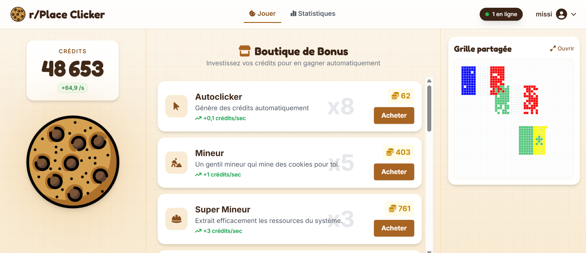
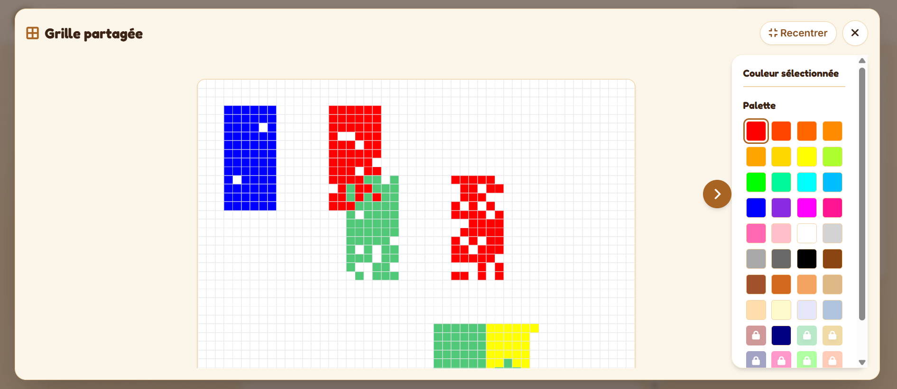

# r/Place Clicker (projet universitaire)
> Un mélange entre le jeu Cookie Clicker et l'expérience r/place. Les joueurs gagnent des crédits en cliquant sur un cookie pour acheter des bonus et poser des pixels de couleur sur une grande grille partagée, où ils se disputent chaque case en temps réel.


  *Page d'accueil*


  *Grande grille partagée*

## Fonctionnalités

- **Clicker** : chaque clic sur le cookie rapporte des crédits, et les bonus en produisent automatiquement.

- **Boutique** : des bonus à acheter pour gagner plus de crédits par seconde, et des couleurs à débloquer.

- **Grille partagée** : une grille de 50 × 50 que tous les joueurs peignent ensemble, mise à jour en direct, avec le nombre de joueurs en ligne affiché dans la barre de navigation.

- **Authentification** : inscription, connexion et modification du profil.

- **Statistiques** : statistiques personnelles et classements des joueurs.

## Stack technique

### Côté serveur

| Techno                     | Rôle                                                        |
| -------------------------- | ----------------------------------------------------------- |
| **Java 21**                | Langage du serveur                                          |
| **Jakarta Servlet**        | Reçoit les requêtes HTTP (clic, achat, connexion…)          |
| **JSP** + **JSTL**         | Génère les pages HTML                                       |
| **WebSocket**              | Diffuse les pixels et les joueurs en ligne en direct        |
| **Apache Tomcat 10.1**     | Exécute l'application                                       |
| **Hibernate 6.4** (JPA)    | Fait le lien entre les classes Java et les tables           |
| **MySQL 8**                | Stocke les joueurs, bonus, pixels et l'historique           |
| **Gson**                   | Convertit les données en JSON pour le JavaScript            |
| **jBCrypt**                | Hache les mots de passe                                     |

### Côté client

| Techno                     | Rôle                                                        |
| -------------------------- | ----------------------------------------------------------- |
| **JavaScript**             | Compteur, boutique et grille, sans framework                |
| **Canvas**                 | Dessine la grille                                           |
| **TailwindCSS 3.4**        | Mise en forme des pages                                     |
| **Fredoka** et **Inter**   | Polices des titres et du texte                              |

### Outils

| Techno                     | Rôle                                                        |
| -------------------------- | ----------------------------------------------------------- |
| **Maven**                  | Gère les dépendances et compile le projet en .war           |
| **Docker** + **docker-compose** | Lance MySQL et l'application en une commande           |

## Modèles de données (JPA)

L'application définit 5 entités :

| Entité        | Table             | Description                                       | Attributs |
| ------------- | ----------------- | ------------------------------------------------- | --------- |
| `Player`      | `players`         | Joueur                                            | `id`, `pseudo`, `password`, `age`, `country`, `credits`, `lastUpdate` |
| `Bonus`       | `bonuses`         | Bonus de la boutique : gain passif (`PASSIVE`) ou couleur (`COLOR`) | `id`, `name`, `description`, `type`, `cost`, `creditsGeneratedPerSecond`, `unlockedColor`, `pixelCount` |
| `PlayerBonus` | `player_bonuses`  | Bonus possédé par un joueur, avec sa quantité     | `id`, `playerId`, `bonusId`, `quantity` |
| `Pixel`       | `pixels`          | Case de la grille, identifiée par ses coordonnées (`PixelId`) | `x`, `y`, `color`, `modificationCount`, `updatedAt`, `playerId` |
| `History`     | `history`         | Historique de chaque pixel peint                  | `id`, `x`, `y`, `color`, `playerId`, `placedAt`, `age` |

Relations principales :

- `Player` **1-N** `PlayerBonus` (via `playerId`)
- `Bonus` **1-N** `PlayerBonus` (via `bonusId`)
- `Player` **1-N** `Pixel` (propriétaire actuel de la case, via `playerId`)
- `Player` **1-N** `History` (via `playerId`)

Les tables sont créées automatiquement au démarrage (`hibernate.hbm2ddl.auto=update`), et les 23 bonus sont insérés si la table `bonuses` est vide.

## Structure du projet

```
rplaceClicker/
├── src/main/
│   ├── java/com/rplace/clicker/
│   │   ├── JpaInitializer.java        # Démarrage de JPA + insertion des bonus
│   │   ├── model/                     # Entités JPA
│   │   │   ├── Player.java
│   │   │   ├── Bonus.java
│   │   │   ├── PlayerBonus.java
│   │   │   ├── Pixel.java
│   │   │   ├── PixelId.java           # Clé composée (x, y) d'un pixel
│   │   │   └── History.java
│   │   ├── dao/                       # Accès à la base
│   │   │   ├── PlayerDAO.java
│   │   │   ├── BonusDAO.java
│   │   │   ├── PlayerBonusDAO.java
│   │   │   ├── PixelDAO.java
│   │   │   └── HistoryDAO.java
│   │   ├── service/                   # Logique métier
│   │   │   ├── PlayerService.java     # Inscription, connexion, validation des champs
│   │   │   ├── BonusService.java      # Calcul des prix
│   │   │   ├── PlayerBonusService.java# Achat de bonus, gain passif, sauvegarde
│   │   │   ├── GridService.java       # Pose d'un pixel
│   │   │   ├── PixelService.java
│   │   │   └── HistoryService.java
│   │   ├── dto/
│   │   │   ├── PlayerStatsDTO.java    # Statistiques d'un joueur
│   │   │   └── PurchaseResult.java    # Résultat d'un achat
│   │   ├── servlet/                   # Routes HTTP
│   │   │   ├── ClickerServlet.java
│   │   │   ├── SaveServlet.java
│   │   │   ├── BonusServlet.java
│   │   │   ├── PlayerBonusServlet.java
│   │   │   ├── LoginServlet.java
│   │   │   ├── RegisterServlet.java
│   │   │   ├── LogoutServlet.java
│   │   │   ├── ProfileServlet.java
│   │   │   ├── UpdateProfileServlet.java
│   │   │   ├── UpdatePasswordServlet.java
│   │   │   └── StatsServlet.java
│   │   └── websocket/
│   │       ├── WebSocket.java         # /grid : état de la grille, pixels en direct, joueurs en ligne
│   │       └── WebSocketConfig.java   # Partage de la session HTTP avec la WebSocket
│   ├── resources/META-INF/
│   │   ├── persistence.xml            # Configuration JPA
│   │   └── persistence.xml.example
│   ├── tailwind/
│   │   └── input.css                  # Source Tailwind (composants : card, input, boutons…)
│   └── webapp/
│       ├── index.jsp                  # Page d'accueil
│       ├── login.jsp
│       ├── register.jsp
│       ├── profile.jsp
│       ├── stats.jsp
│       ├── error.jsp                  # Pages 404 / 500
│       ├── nav.jsp                    # Barre de navigation
│       ├── WEB-INF/
│       │   ├── web.xml
│       │   └── jspf/rank.jspf         # Médaille d'un rang du classement
│       ├── css/tailwind.css
│       ├── images/cookie.png
│       └── js/
│           ├── clicker.js             # Clic, compteur, boutique
│           ├── autosave.js            # Sauvegarde automatique
│           ├── grid.js                # Grande grille (WebSocket, zoom, palette)
│           ├── gridPreview.js         # Aperçu de la grille sur l'accueil
│           ├── stats.js
│           ├── forms.js               # Afficher / masquer le mot de passe
│           └── toast.js               # Notifications
├── Dockerfile
├── docker-compose.yml                 # Lance MySQL et l'application
├── tailwind.config.js
├── package.json
└── pom.xml                            # Configuration Maven
```

## Démarrage

### Avec Docker

Prérequis : **Docker** et **Docker Compose**.

```bash
# 1. Cloner le dépôt
git clone https://github.com/missipsa-bouhadad/rplaceClicker.git
cd rplaceClicker

# 2. Lancer MySQL et l'application
docker compose up --build
```

L'application est ensuite disponible sur [http://localhost:8080](http://localhost:8080).

> **Remarque :** pour changer le port, utiliser `APP_PORT` :
> - Windows (PowerShell) : `$env:APP_PORT=9090; docker compose up --build`
> - Linux / macOS : `APP_PORT=9090 docker compose up --build`

### Sans Docker

#### Prérequis

- **Java 21**
- **Maven**
- **MySQL 8**
- **Apache Tomcat 10.1**
- **Node.js** (seulement pour recompiler le CSS Tailwind)

#### Variables d'environnement

| Variable      | Description                         | Valeur par défaut |
| ------------- | ----------------------------------- | ----------------- |
| `DB_URL`      | URL JDBC de la base MySQL            | `jdbc:mysql://localhost:3306/rplace_clicker_db` |
| `DB_USER`     | Utilisateur MySQL                    | `root` |
| `DB_PASSWORD` | Mot de passe MySQL                   | `root` |

> **Remarque :** ces variables sont lues dans `JpaInitializer.java`. Sans elles, les valeurs par défaut sont utilisées.

#### Installation

```bash
# 1. Cloner le dépôt
git clone https://github.com/missipsa-bouhadad/rplaceClicker.git
cd rplaceClicker

# 2. Créer la base de données
=> Créer une base nommée 'rplace_clicker_db' dans MySQL (les tables sont créées au démarrage)

# 3. Configurer l'accès à la base
=> Définir DB_URL, DB_USER et DB_PASSWORD si les valeurs par défaut ne conviennent pas

# 4. Compiler le projet
mvn package

# 5. Déployer sur Tomcat
=> Copier 'target/rplace-clicker-1.0-SNAPSHOT.war' dans 'webapps/' de Tomcat sous le nom 'ROOT.war'
   (supprimer l'ancien dossier 'webapps/ROOT' au premier déploiement)

# 6. Lancer Tomcat
=> 'bin/startup.bat' (Windows) ou 'bin/startup.sh' (Linux / macOS)
```

L'application est ensuite disponible sur [http://localhost:8080](http://localhost:8080).